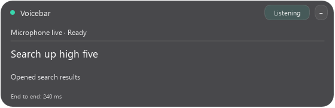
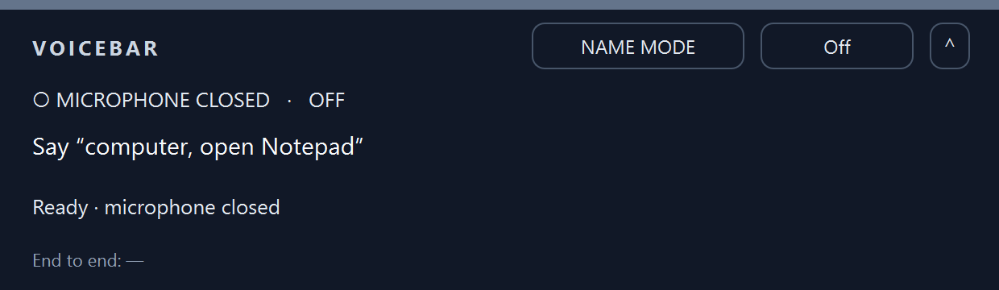

<div align="center">

# Voicebar

**A local, offline voice command bar for Windows 11.**

Say *"computer, open Chrome"*, *"maximize Notepad and move it to the other screen"* or *"type hello world and press enter"*.<br>
Speech recognition, command parsing and execution all run on the laptop. No cloud, no accounts, no API keys.




</div>

> [!NOTE]
> **Archived v1.** Voicebar works for a fixed set of commands, but it is too rigid and too slow to use all day (numbers below). I'm rebuilding it from scratch as a new project; this repo stays up as a reference and a record of what didn't work.

## Contents
- [What it does](#what-it-does)
- [How it works](#how-it-works)
- [Results](#results)
- [What I learned](#what-i-learned)
- [Quick start](#quick-start)
- [Using it](#using-it)
- [Configuration](#configuration)
- [Privacy and safety](#privacy-and-safety)
- [Known limits](#known-limits)
- [Project layout](#project-layout)
- [How it was built](#how-it-was-built)
- [Acknowledgements](#acknowledgements)

## What it does
- **Apps:** open, switch to and close any Start-menu app by name or alias.
- **Windows:** maximize, minimize, restore, snap left/right, move to another monitor.
- **Typing:** type dictated text, press key chords, scroll. A dictation mode types everything you say until "stop dictation".
- **Browser:** new / close / next / previous tab, reopen a closed tab, back / forward / reload, open saved sites, search Google, YouTube or GitHub.
- **Media:** volume up / down / mute, play / pause, next / previous track.
- **Wake name + follow-up:** commands start with "computer"; after one runs, an 8-second follow-up window takes the next command without the name. Sleep and wake by voice.
- **Push-to-talk and hotkeys:** hold Ctrl+Alt+F8 for one deliberate command; the Copilot key (or Ctrl+Alt+F9) toggles listening.
- **App-specific commands** defined in YAML (`config/apps/*.yaml`), built only from existing safe steps.
- **Optional local fallbacks:** a small Ollama text model for phrasings the parser can't read, and a small local vision model to pick an on-screen control.
- **Status pill:** a bar at the top of the screen shows what it heard, what it did and the end-to-end time.

<p align="center">
  <br><br>
  
</p>

## How it works
```text
microphone ─► speech segments (Silero VAD) ─► local speech-to-text ─► gate ─► tier-1 parser ─► plan ─► executor ─► bar
                                                                        │
                                   unparsed, but addressed to "computer" ─► tier-2 resolver (local Ollama model)
```
One Python process. Audio, recognition and execution run off the UI thread and talk through queues.

Design rules it was built under (full list in [`AGENTS.md`](AGENTS.md)):
1. **Local only.** No network at runtime; models are downloaded once by `scripts/setup.py`. No listening sockets: the only connection allowed is a client to a local Ollama on 127.0.0.1.
2. **Closed action set.** The executor accepts a fixed list of actions. There is no shell, file-delete or system-settings action (volume and media keys only).
3. **Code decides, models select.** Text to type or search is cut from the transcript by code; a model may only choose among options that code produced.
4. **Unsure means do nothing.** Unknown or ambiguous input causes no action, and the bar shows what was heard.

**Speech-to-text backends** (swappable behind one interface): Qwen3-ASR 1.7B on CUDA (the selected default), NVIDIA Parakeet TDT, Whisper large-v3 / large-v3-turbo, Moonshine.
**Executor:** Win32 + UI Automation through `comtypes`. **UI:** PySide6.

## Results
Measured on one laptop ([test machine](docs/MACHINE.md)).

**Speech-to-text on 40 recorded commands.** "Exact plans" means the parsed action matched exactly; latency is from the end of speech to the final text ([details](docs/STAGE3-GATE.md)).

| Backend | Exact plans | p50 | p95 |
|---|---:|---:|---:|
| **Qwen3-ASR 1.7B, CUDA, grammar + catalog context** (selected) | **35/40** | 1,419 ms | 2,538 ms |
| Qwen3-ASR 1.7B, CUDA, catalog only | 33/40 | 2,044 ms | 4,566 ms |
| Whisper large-v3, CUDA | 30/40 | 1,219 ms | 2,128 ms |
| Whisper large-v3-turbo, CUDA | 28/40 | 535 ms | 1,032 ms |
| Parakeet, CUDA | 28/40 | 242 ms | 485 ms |
| Parakeet, CPU | 26/40 | 181 ms | 460 ms |
| Moonshine Small Streaming, CPU | 24/40 | 4,201 ms | 9,220 ms |

**A live session of 20 utterances** ([details](docs/STAGE11-LATENCY.md)):

| Measurement | Median | p95 |
|---|---:|---:|
| Speech recognition | 964 ms | 1,243 ms |
| End of speech → action starts | 1,380 ms | 4,282 ms |
| End of speech → final result | 1,535 ms | 6,736 ms |

Visual fallbacks (picking an on-screen control with the vision model) took 5.2–5.4 s and timed out. The vision model had been unloaded after five idle minutes and couldn't reload in time, because the speech model was holding most of the 8 GB GPU (reproduced in testing).

## What I learned
- **A strict grammar fights natural speech.** Every word had to parse, so anything phrased slightly differently did nothing.
- **Measure what matters.** The accuracy test compared exact strings, so "Hello World" vs "hello world" or "lo-fi" vs "lofi" counted as misses (3 of the selected model's 5). That metric picked a ~1.4 s model over Parakeet at ~0.24 s.
- **One small GPU, one model.** Keeping speech, text and vision models resident on an 8 GB laptop GPU caused the reload timeouts above.
- **Process vs product.** The project ran as 11 gated stages with heavy verification; much of the effort went into proving each stage rather than making commands feel natural.

The rewrite moves speech-to-text to the CPU, uses a small on-demand local model for loose phrasing, clicks web pages through their structure instead of screenshots, and learns new commands by demonstration.

## Quick start
Requirements: Windows 11 (native PowerShell), [Git](https://git-scm.com/) and [uv](https://docs.astral.sh/uv/). No administrator rights, WSL or Docker needed. An NVIDIA GPU is only needed for the CUDA speech backends ([`docs/CUDA.md`](docs/CUDA.md)).

```powershell
git clone https://github.com/Bhavya007-17/voicebar
cd voicebar
uv sync --locked
uv run voicebar init --portable    # conservative defaults: empty aliases, no pinned apps
uv run voicebar apps --refresh     # index Start-menu apps
uv run python scripts/setup.py     # downloads and hashes the speech models once
uv run voicebar doctor             # checks microphone, models and hotkeys
uv run voicebar app                # starts the bar (it starts Off)
```

Portable defaults leave the speech backend unset. For a CPU smoke test, synthesize a sample, check its plan, then select the backend in `config/settings.yaml`:

```powershell
uv run python scripts/synthesize_stage3.py
uv run voicebar wav fixtures/synthetic/command-001-rate0.wav --dry-run --backend moonshine
```

```yaml
stt:
  backend: moonshine
  device: cpu
```

The selected configuration is `qwen` on `cuda`; run `uv run python scripts/setup.py --candidate qwen` before choosing it.

## Using it
The app starts **Off**. Wait for model-ready feedback, then press the Copilot key (or Ctrl+Alt+F9) to start listening.

```text
computer open Notepad
computer maximize Notepad and move it to the other screen
computer type Hello, World! and press enter
computer search google for tomorrow's weather
computer new tab
computer go back
computer start dictation   …   stop dictation
computer sleep   /   computer wake up
```

- Commands chain with "and", "then" or commas. "It" means the app named earlier.
- Hold **Ctrl+Alt+F8** to record one command; release to run it.
- **Ctrl+Alt+F10** shows or hides the bar. The tray icon has on/off, start with Windows, and quit.
- Full grammar: [`docs/COMMANDS.md`](docs/COMMANDS.md).

## Configuration
Everything lives in `config/` and reloads while the app runs (invalid YAML keeps the last good config):
- `settings.yaml`: wake name, speech backend, hotkeys, silence timing, resolver and vision models, logging.
- `aliases.yaml`: spoken names for installed apps (`editor: Notepad`).
- `sites.yaml`: named sites ("computer open project docs").
- `pinned.yaml`: apps allowed in the opt-in open mode (no wake name).
- `apps/<app>.yaml`: app-specific commands built from existing steps.

`voicebar plan "select everything in Notepad"` shows a plan without running it, `voicebar inspect` lists UI Automation selectors for an app, and `voicebar teach` turns an unresolved phrase into an alias after you review it.

## Privacy and safety
- Runs offline after setup. Logs stay in `logs/` and can omit transcripts (`logs.keep_transcripts: false`).
- Turning it Off or locking Windows closes the microphone stream, not just mutes it.
- Unknown or ambiguous speech does nothing. Open mode (no wake name) only allows safe commands for pinned apps.
- Anything the microphone hears can issue commands: the wake name is an input gate, not speaker authentication.

## Known limits
- Elevated (admin) windows can't receive input from a normal process.
- Some custom editors, browser tab titles and controls can't be identified through Windows automation.
- Recognition is imperfect and cold model loading takes time; the selected model missed the original accuracy and latency targets.
- Exclusive full-screen apps can hide the bar; use the hotkeys there.

## Project layout
```text
voicebar/catalog.py    apps, aliases, sites, search engines (Start menu + config)
voicebar/parser.py     tier 1: text → list of actions, or None (pure, no I/O)
voicebar/schema.py     validates actions against the closed set
voicebar/gate.py       wake name, follow-up window, open mode, sleep, dictation
voicebar/executor/     Win32 / UI Automation implementation, one module per action family
voicebar/audio.py      microphone capture and speech segmentation
voicebar/stt/          speech-to-text backends behind one interface
voicebar/resolver/     tier-2 local model backends (Ollama text + vision)
voicebar/ui/           bar, tray icon, hotkeys
voicebar/cli.py        plan, run, wav, listen, app, apps, inspect, teach, doctor
config/                settings, aliases, sites, pinned apps, app commands
docs/                  commands, decisions, stage reports, test machine
seed/, tests/          the parser/gate contract and unit tests
```

## How it was built
Built in October 2026 with OpenAI Codex as the coding agent, in 11 stages that each ended with a measured gate. [`AGENTS.md`](AGENTS.md) holds the rules the agent followed, `docs/STAGE*-GATE.md` are the stage reports, and [`docs/DECISIONS.md`](docs/DECISIONS.md) records the dependency and API choices. Raw evidence logs and the voice recordings used for testing are not included in this public repo, so some links in the stage reports point to files that aren't here.

## Acknowledgements
[Silero VAD](https://github.com/snakers4/silero-vad) · [NVIDIA Parakeet](https://huggingface.co/nvidia) via [onnx-asr](https://github.com/istupakov/onnx-asr) · [Qwen3-ASR](https://huggingface.co/Qwen) · [Whisper](https://github.com/openai/whisper) · Moonshine · [Ollama](https://ollama.com) · [PySide6](https://doc.qt.io/qtforpython-6/) · [RapidFuzz](https://github.com/rapidfuzz/RapidFuzz) · design ideas from [Atticus](https://github.com/SaarthurR/atticus-mac) ([notes](docs/ATTICUS-REFERENCE.md)).
