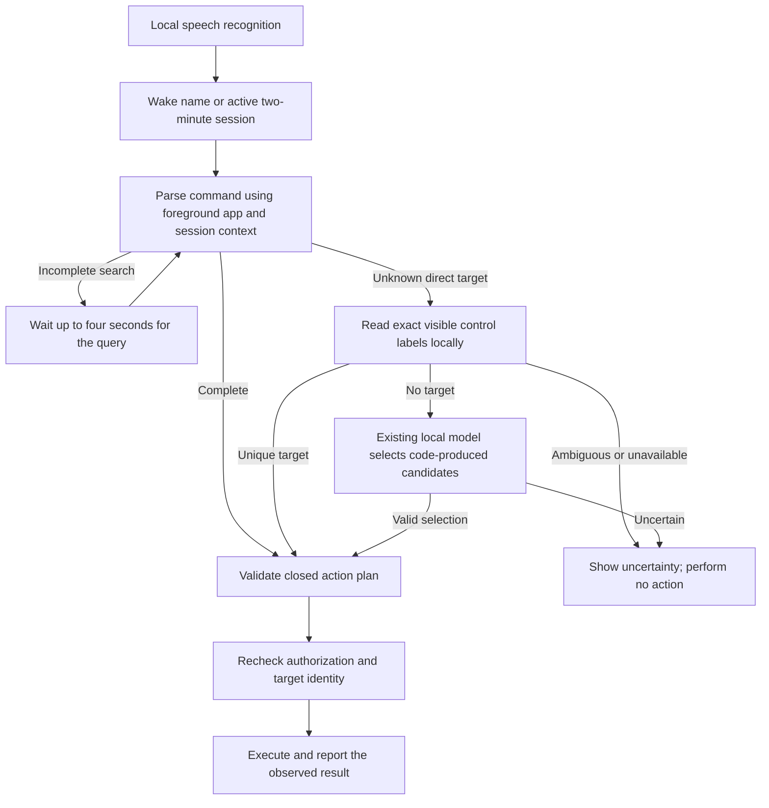

# Stage 9: fast local command sessions

The design keeps common commands on the existing code path and asks for more
context only when needed. The user-facing bar is a compact gray pill which
expands for the transcript and result.

## Implemented behavior

- Say `computer` once. Follow-ups remain eligible until 120 seconds without
  speech. The pill distinguishes an active session from “Wake name needed.”
  Background action words do not start a session by themselves.
- `search up` followed by `High Five!` within four seconds retains the literal
  query. A complete new command or cancellation replaces that pending search.
- With Calculator active, `type two plus three` and `add two plus three` send
  the calculation immediately. Outside Calculator, typing stays literal.
  One binary operation is supported; this is not a general math language.
- `open a Chrome tab`, `close a Chrome tab`, and `open new browser window`
  distinguish tabs from windows. The window command requires an active verified
  browser. Opening a site uses a new tab when the verified default browser is
  already foreground.
- `click Calendar` and `click link Calendar` use exact visible UIA labels.
  A follow-up such as `open calendar` can select a uniquely observed control
  without a Canvas-specific script. Focus changes or ambiguous labels refuse.
- `close YouTube` can select an observed matching tab in the foreground browser
  window. Multiple candidates use uniquely known recency, otherwise the bar
  shows the ambiguity. A follow-up can explicitly switch to the exact tab title
  and then close it. Tab titles are labels, not proof of a site's origin.
- Temporary app/tab references reset on expiry, Off, lock, sleep and reload.
  Preferences and existing taught commands remain on disk. There is no automatic
  learning from arbitrary speech. Existing local decision logs still follow the
  configured transcript-retention policy.

## Boundaries and next stage

This stage does not install a vision model or add screenshot inference. Apps
without useful accessibility labels, semantic requests such as “today's
dynamic assignment,” and unnamed camera controls still need further work.
The code does not invent URLs, screen coordinates, or scripts for those tasks.
Browser recency is based on command-time observations within the current
window; it does not continuously watch manual tab changes across all windows.

The current speech recognizer remains the main latency concern. Reducing that
delay needs a measured comparison on the user's recordings and hardware before
changing the default. “Zero latency” is not an achieved result of this stage.
Any future local visual fallback should only select fresh observed targets and
preserve the existing closed action set, refusal rules and identity checks.

Restart Voicebar to load the new Python code and pill style. The existing
microphone toggle and hold-to-talk controls remain available.
